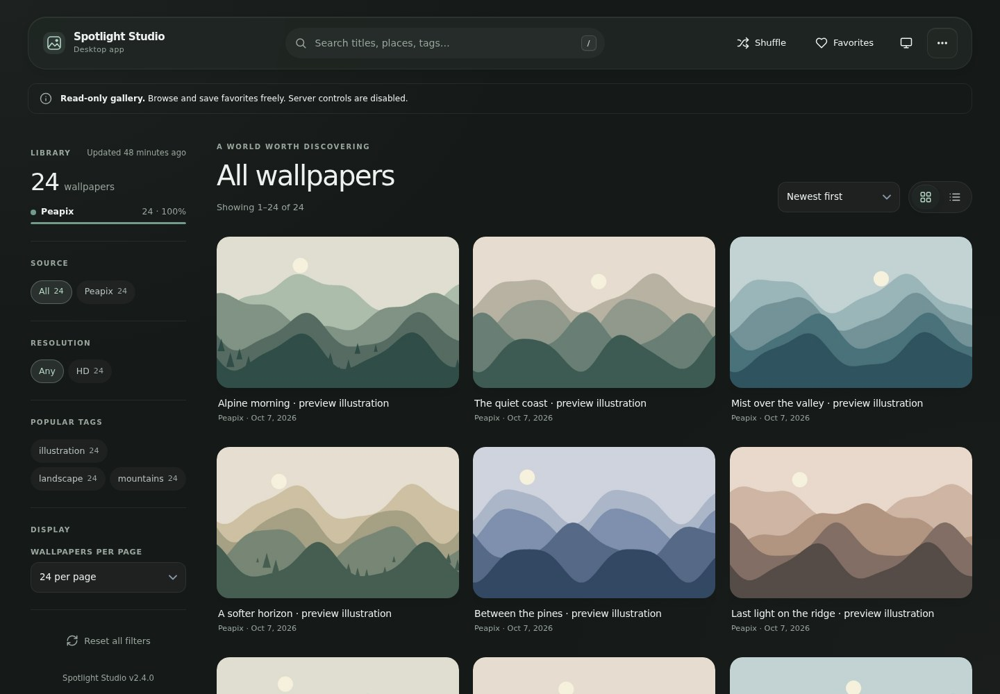
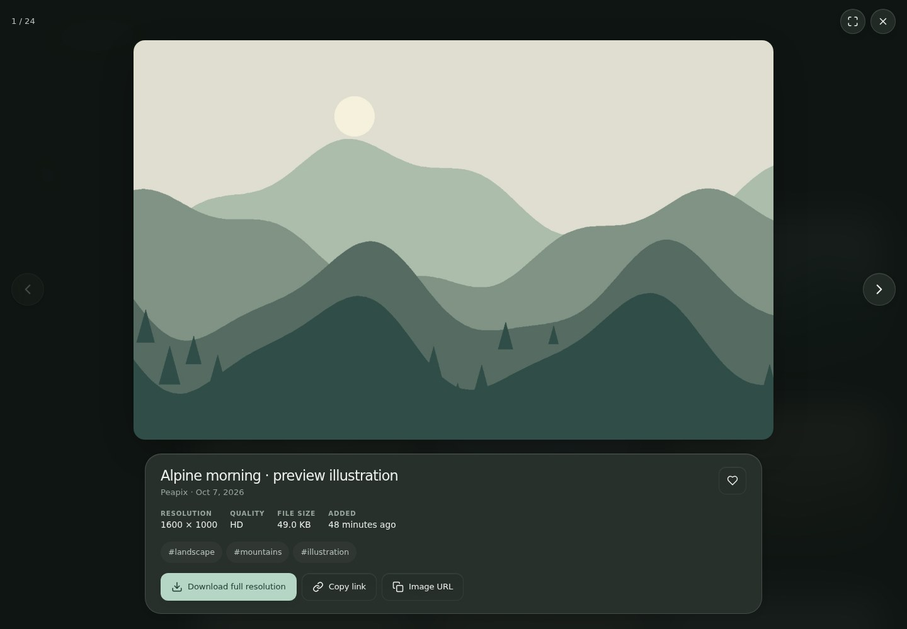
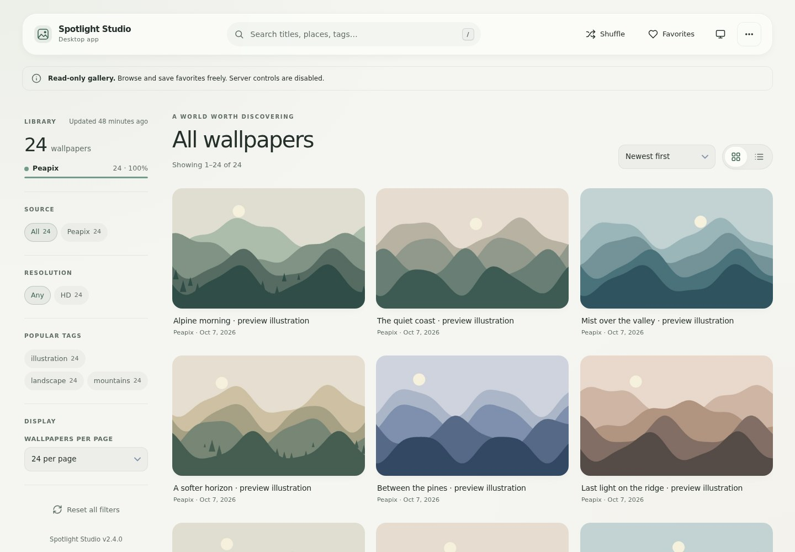
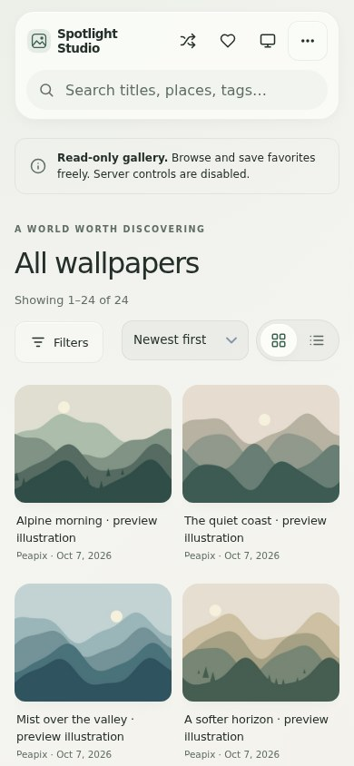

# Spotlight Studio

**An archive and gallery of Windows Spotlight wallpapers** — crawl them from Peapix and Windows10Spotlight, de-duplicate them by perceptual hash, keep the best resolution of every picture and browse the whole collection in the restrained **Liquid Glass** interface, either as a static GitHub Pages showcase or as a desktop app with crawler controls.

[](https://github.com/KetanDutt/SpotlightStudio/actions/workflows/ci.yml)




| Viewer | Light theme | Mobile |
|:---:|:---:|:---:|
|  |  |  |

<sub>Liquid Glass screenshots use generated placeholders, not real wallpapers; the new daily card is not shown in these snapshots.</sub>

---

## Highlights

| | |
|---|---|
| 🖼️ **~7,500 wallpapers** | 4K (Peapix) and Full HD (Windows10Spotlight), perceptually de-duplicated; the best resolution of each picture wins |
| ⚡ **Fast & bounded** | Async crawling with a configurable in-flight image cap, one CPU job per image, atomic writes; a compact catalog parsed once and searched in memory |
| 🛡️ **Reliable** | queue claims recover on restart; safe graceful stop and single-process ownership; automatic retries; a circuit breaker for network outages; page counts are auto-discovered |
| 🔎 **Great browsing** | UTC daily spotlight, instant multi-term search, tag & resolution filters, portable favorites, shareable deep links (`#w=1234`), random wallpaper, keyboard shortcuts, light/dark theme |
| 📱 **Installable PWA** | works on phones, offline-capable, accessible (keyboard, screen-reader, reduced-motion) |
| 🤖 **Android / iOS app** | Expo client: offline search, favourites, history, **set the wallpaper on Android** (home/lock/both) with automatic rotation; on iOS it saves to Photos and guides you through the Shortcuts step ([details](docs/MOBILE.md#setting-a-wallpaper)) |
| 📺 **Roku TV channel** | pure 2D canvas (`roScreen`) gallery with Ambient Mode, a deterministic Daily Spotlight, six Liquid Glass palettes, search and Roku Pay Pro — plus a separate standalone screensaver app ([details](docs/roku/README.md)) |
| 🔒 **Locked down** | strict CSP, Host/Origin checks on the local API, no XSS from scraped titles, CSV-injection-safe exports, DB and logs are never served |

## What’s new in 2.8.1 — project hardening

- **Broader release-blocking CI:** Python/JavaScript tests, static-site and catalog checks, Roku static audit, hermetic Chromium browser flows, and mobile TypeScript/ESLint/Jest checks. GitHub Pages deploys only after all platform jobs pass; failed browser runs retain Playwright traces for seven days.
- **Safer media repair:** Existing Git LFS preview pointers are now treated as missing and regenerated after hydration. Preview backfills use bounded CPU batches, avoid encoding throwaway previews for metadata-only repairs, and report preview and metadata counts separately.
- **Reject mislabeled originals:** Image formats without a matching preserved file extension are rejected instead of being stored as JPEG-named GIF/TIFF bytes.

## What’s new in 2.7 — Roku production readiness

- **Certification-clean Roku channel:** Back now walks grid → tab bar → exit (requirement 4.6), the package is 2.65 MB (requirement 3.7 caps it at 4 MB; the catalog alone used to be 4.18 MB), artwork is fully opaque (6.4), the version is non-zero (6.1), and every deprecated API is gone.
- **4K wallpapers actually display:** `roBitmap` cannot decode above 2048×2048, so full frames now load through `roTextureManager` at screen size; the viewer's fit maths was rewritten in floats.
- **Reliable input and rendering:** a dirty-frame renderer that idles at ~0 % CPU, 20/60 fps animation budgets, bounded LRU bitmap caches, and a fix for the loop dropping the first key press after every idle period.
- **New features:** on-screen search keyboard, live palette switching in Theme Studio, menu backdrop, Ambient rotation pools, resume-last-position, system navigation sounds, Direct-to-Play deep links while running.
- **Honest licensing:** Roku Pay entitlements are re-synced with `GetPurchases()` on every launch and subscriptions expire; the misleading "change your Roku home wallpaper/screensaver" copy is gone, replaced by a separate standalone screensaver app (`roku-screensaver/`).
- **A static gate for the bugs the compiler cannot see:** BrightScript returns `invalid` for a missing associative-array key and only discovers a call to a non-existent Roku method at *runtime*. `make roku-audit` now fails the build on both — and it immediately found `roBitmap.DrawResizedObject()` (no such method) and `roFont.SetSize()` (no such method), either of which crashed the channel before it drew a single pixel. See [`docs/roku/AUDIT.md`](docs/roku/AUDIT.md).
- **Theme Studio auto-rotation actually rotates:** the *Auto-switch* row now drives a real timer that walks the rotation pool and assigns the Ambient wallpaper and/or the menu backdrop on schedule, instead of only persisting the setting.
- **Faster on the whole archive:** the "Title A→Z" sort is a stable merge sort instead of an insertion sort (≈28 M comparisons → ≈97 K on 7,475 rows), wallpaper-id lookups are O(1) instead of a per-frame linear scan, and rounded rectangles, chips, pills, spinners and focus underlines are drawn from a bounded bitmap cache instead of ~1 000 `DrawRect()` calls per frame.
- **Tooling:** `make roku-audit` (static gate), `make roku-lint` (BrighterScript compile gate), `make roku-check` (audit + certification pre-flight), `make roku-zip`, `make roku-catalog`, `make roku-art`; thirteen documents in `docs/roku/` including a field-by-field [`STATE.md`](docs/roku/STATE.md) and the Roku API traps in [`AUDIT.md`](docs/roku/AUDIT.md).

## What’s new in 2.6 — Roku TV, daily automation and polish

- **Roku TV channel:** A dedicated 10-foot living room experience built on a 60 fps double-buffered 2D canvas with home-screen theme switcher, ambient screensavers, trial mode, and in-app purchase store architecture.
- **Daily automation & CLI:** `python main.py --daily` prints today's deterministic pick and `--set-daily` immediately applies it to your desktop background across Windows, macOS, and Linux. `--rotate-daemon --rotate-hours 6` rotates local backgrounds; `--rotate-tag mountains` and `--rotate-favorites backup.json` scope the pool.
- **Smaller, richer media:** New downloads generate a thumbnail, a 1440px WebP preview, and palette/aspect metadata. Browsing uses previews; full-resolution downloads remain explicit. Run `POST /api/maintenance/previews` after `git lfs pull` to backfill existing files.
- **Discovery and organization:** Filter by orientation and dominant color, pan/zoom the viewer, multi-select wallpapers for favorites or ZIP downloads, and create named local collections.
- **Windows integration:** Choose Fill/Fit/Stretch/Tile/Center/Span and assign wallpapers per display from the desktop viewer. `GET /api/desktop/monitors` lists target IDs.
- **System tray (optional):** Install `requirements-desktop.txt`, then run `python main.py --tray` for quick Next/Daily wallpaper actions and crawler controls without keeping the window open. The tray tooltip shows crawler progress.
- **Enhanced API:** `/api/wallpapers/daily` and `/api/wallpapers/daily/image` endpoints for scheduled background rotations and script integration.
- **Expanded keyboard controls:** `T` to cycle theme (dark, light, system) and `W` to apply the current wallpaper in desktop mode.
- **Obsidian Liquid Glass branding:** Unified master asset generator producing 4x supersampled adaptive icons and splash screens across web, mobile, and television.

## Four ways to use it

| Mode | What you get | How |
|---|---|---|
| **Static showcase** | browse, search, favorite, download | publish the allow-listed static build to GitHub Pages ([guide](docs/DEPLOYMENT.md)) |
| **Desktop / server** | everything above **plus** crawler controls, live progress, repair tools, *Set as wallpaper*, full exports | run the app locally |
| **Mobile app** | the same catalog on Android/iOS with favourites, history and offline search — and real *set wallpaper* plus background rotation on Android | `cd mobile && npm ci && npm start` ([guide](docs/MOBILE.md)) |
| **Roku TV channel** | 7,475 wallpapers on your TV with Ambient Mode, a theme studio, search and remote navigation — plus a standalone screensaver app | sideload to Roku or run in simulator ([guide](docs/roku/README.md)) |

The same `index.html` serves the two browser modes: it detects a Spotlight Studio backend on its own origin and unlocks the crawler console when one answers. The mobile app is a separate client in `mobile/` and reads the same catalog.

## Quick start

> **Git LFS:** the wallpapers are stored in [Git LFS](https://git-lfs.com/). Install it **before** cloning (`git lfs install`), or run `git lfs pull` afterwards — otherwise every image is a 130-byte pointer file. The app warns you if that happens.

### Windows

1. Install [Python 3.10+](https://www.python.org/downloads/) (tick *Add python.exe to PATH*).
2. Double-click **`start_desktop.bat`** — it creates the virtual environment, installs the dependencies and opens the app window.

| Launcher | Purpose |
|---|---|
| `start_desktop.bat` | native window (WebView2) – falls back to your browser automatically |
| `start_server.bat` | headless server – open <http://127.0.0.1:8765/> |
| `start_update.bat` | no UI: fetch what is new and exit – schedule it daily ([how](docs/DEPLOYMENT.md#automatic-updates)) |

### Linux / macOS

```bash
git lfs install && git clone https://github.com/KetanDutt/SpotlightStudio.git && cd SpotlightStudio
python3 -m venv .venv && . .venv/bin/activate
python -m pip install --upgrade pip setuptools
pip install -r requirements.txt
python main.py --server            # then open http://127.0.0.1:8765/
```

(`python main.py` opens a native window where PyWebView is available and otherwise falls back to the browser. `make help` lists more shortcuts.)

## Using it

### The crawler (desktop / server mode)

Open the **Crawler** panel in the sidebar, choose a **source** and a **mode**, press **Start**:

| Mode | What it does | Typical time |
|---|---|---|
| **Quick update** | scans the newest `QUICK_UPDATE_PAGES` (3) pages of each site and fetches only what is new | seconds |
| **Full crawl** | discovers the real page count, scans every page, resumes any unfinished backlog | minutes |
| **Repair metadata** | re-reads gallery/post pages to fill in missing **titles and tags** of wallpapers you already have (no image downloads) | minutes |

Pause, resume and stop at any time — unfinished work stays in the queue. Progress, speed, queue size and a summary of the last run are shown live.

### Command line

```bash
python main.py                         # desktop window
python main.py --server [--host 0.0.0.0 --port 8765]
python main.py --daily                 # print today's daily spotlight wallpaper JSON
python main.py --set-daily             # set today's daily spotlight as desktop wallpaper
python main.py --rotate-daemon --rotate-hours 6 --rotate-tag mountains
python main.py --tray                  # optional system tray companion
python main.py --set-wallpaper 42      # set specific wallpaper ID as desktop wallpaper
python main.py --crawl --mode quick    # one-shot update without UI (cron / Task Scheduler)
python main.py --crawl --mode full --source peapix
python main.py --crawl --mode repair   # back-fill titles and tags
python main.py --check                 # database ⇄ files health report (exit code 2 if problems)
python main.py --sync-catalog          # regenerate data/wallpapers.json
```

### Keyboard shortcuts

`/` search · `R` random wallpaper · `F` favorite / favorites view · `T` cycle theme · `W` set as wallpaper · `←` `→` previous / next · `C` copy link · `D` download · `Enter` fullscreen · `Esc` close · `?` help

### Favorites backup

Use **More options → Back up favorites** to download `spotlight-favorites.json`.
**Restore favorites** merges a version-1 backup without deleting existing favorites.
Backups contain relative image filenames, not image bytes. Limits: 2 MB import / 20,000
favorites. Unknown keys are retained for later catalogs. Storage is local to each browser;
backup before clearing site data. The same version-1 favorites JSON format works in the web and mobile apps.

## Configuration

Copy `.env.example` to `.env` (the Windows launchers do it for you). Everything has a sensible default and invalid values fall back to it with a warning. The most useful settings:

| Setting | Default | |
|---|---|---|
| `CONCURRENT_DOWNLOADS` | `32` | worker slots; active image pipelines are also capped by `MAX_INFLIGHT_IMAGES` |
| `MAX_INFLIGHT_IMAGES` | `8` | cap fetch→decode→store memory usage |
| `QUICK_UPDATE_PAGES` | `3` | pages per site scanned by a quick update |
| `HOST` / `PORT` | `127.0.0.1` / `8765` | bind address (non-loopback ⇒ read [the security notes](docs/SECURITY.md)) |
| `READ_ONLY` | `false` | disable all HTTP mutations for a public gallery |
| `VERIFY_SSL` | `true` | TLS certificate verification |

Full reference: [docs/CONFIGURATION.md](docs/CONFIGURATION.md).

## Project layout

```
main.py                 entry point (desktop · server · crawl · tray · rotation · maintenance)
src/
  config.py             validated settings from .env
  database.py           SQLite schema v4, claim queues, search, catalog export
  scrapers.py           Peapix + Windows10Spotlight parsers, page discovery, title enrichment
  downloader.py         capped fetch → image analysis → perceptual dedupe → atomic storage
  engine.py             crawl orchestration, bounded workers, retry/breaker/pause/stop
  maintenance.py        dedupe, thumbnail/preview repair, health check, startup recovery
  storage.py            safe file paths, atomic writes, Git-LFS pointer detection
  tray.py               optional system-tray desktop controls
  api.py · security.py  FastAPI, Host/Origin checks, CSP and security headers
  wallpaper.py          Windows monitor/fit controls plus platform wallpaper setters
index.html              single-page gallery and desktop UI
static/                 CSS, pure catalog logic, browser UI, API docs and icons
sw.js · manifest.webmanifest   PWA shell and offline catalog behavior
data/                   SQLite database and public static catalog
images/                 original images, previews and thumbnails (Git LFS)
tests/                  Python, Node, hermetic browser, and Roku audit regressions
mobile/                 Expo client for Android and iOS
docs/                   architecture, API, operations, security, platform and release guides
scripts/                catalog/site/Roku tooling and asset generators
start_*.bat · Makefile  Windows launchers and developer shortcuts
.github/workflows/      blocking CI jobs and GitHub Pages deployment
```

## How it works (in short)

1. **Scrape** gallery pages (parsers are structure-agnostic: they rely on content patterns, not CSS class names).
2. **Queue** every unknown image URL in SQLite.
3. **Download** with bounded async workers; each fetch→decode→preview→store pipeline consumes a limited memory slot.
4. **De-duplicate** with a 256-bit difference hash: near-duplicates (Hamming distance ≤ 4) keep the higher resolution and merge titles/tags.
5. **Export** a compact `data/wallpapers.json` that the static site loads.

Details and diagrams: [docs/ARCHITECTURE.md](docs/ARCHITECTURE.md).

## Development

```bash
pip install -r requirements-dev.txt
ruff check . && pytest                 # 345 Python tests; crawler tests use fake source sites
node --test tests/js/*.test.mjs         # 31 DOM-free JavaScript tests
npm ci && npm test                      # root tooling; run browser suite with `make browser`

cd mobile                               # Expo client (supported Node 22.13+ LTS)
npm ci && npm run verify                # typecheck + lint + 209 Jest tests
npm run android                         # dev build on a device/emulator
```

Contributions are welcome — see [CONTRIBUTING.md](CONTRIBUTING.md) and [docs/DEVELOPMENT.md](docs/DEVELOPMENT.md).

## Documentation

| | |
|---|---|
| [Architecture](docs/ARCHITECTURE.md) | components, data flow, concurrency and reliability model |
| [REST API](docs/API.md) | every endpoint with examples |
| [Configuration](docs/CONFIGURATION.md) | all environment variables |
| [Deployment](docs/DEPLOYMENT.md) | GitHub Pages, local/headless use, scheduled updates, upgrading |
| [Front-end](docs/FRONTEND.md) | modules, URL parameters, CSP, service worker |
| [Mobile app](docs/MOBILE.md) | Android & iOS client: set-wallpaper capabilities, rotation, EAS builds |
| [Roku TV channel](docs/roku/README.md) | Roku channel docs: architecture, controls, certification, performance, Roku Pay, screensaver |
| [Data formats](docs/DATA.md) | catalog JSON, database schema, normalisation rules |
| [Security](docs/SECURITY.md) | threat model and hardening |
| [Troubleshooting](docs/TROUBLESHOOTING.md) | common problems and fixes |
| [Roadmap](docs/ROADMAP.md) | suggested improvements |
| [Changelog](CHANGELOG.md) | release notes |

## Release documentation

[Documentation index](docs/README.md) · [Project review](docs/REVIEW.md) ·
[Release and rollback checklist](docs/RELEASE_CHECKLIST.md)

```bash
# Build the public site (no Python dependencies needed for this command)
python scripts/build_site.py            # publish dist/site only

# Optional real-browser checks; activate the Python virtualenv first
npm ci
npx playwright install --with-deps chromium
npm run test:browser                    # uses disposable fixture data, not your library
```

## License & disclaimer

© 2026 Ketan Dutt. **All rights reserved** — the repository is provided for viewing and evaluation; see [LICENSE](LICENSE) (contact in the license file for commercial use).

Spotlight Studio is an unofficial project. It is not affiliated with or endorsed by Microsoft, Peapix or Windows10Spotlight. The wallpapers remain the property of their respective copyright holders.
